<div align="center">

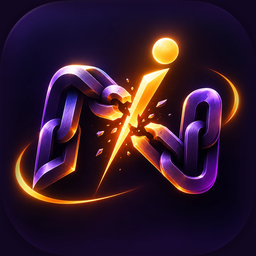

# NixUra

**Quit what drains you. Build what lifts you. Count down to what matters.**

An offline-first habit app for **Android and iOS**, written once in **Kotlin Multiplatform** and **Compose Multiplatform**.


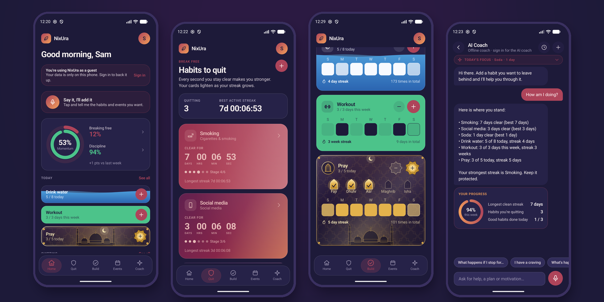

</div>

## What is NixUra?

NixUra helps people **break bad habits**, **build good ones** and **look forward to important moments**.

- **Quit counters** run live to the second since the last slip. Each card starts in a deep shade and lightens as the streak grows (0, 1, 3, 7, 14 and 30 days), with a body-and-mind recovery timeline and an optional money-saved tracker.
- **Good habits** have a daily target (for example 8 glasses of water) or run N days a week, with a month calendar, streaks and completion rates. Water habits fill with rising water, and prayer habits turn into a gold card with the five daily prayers.
- **Events** count down live, with as many reminders as you like. They can also be imported from Google Calendar or Notion.
- **The coach** works fully offline with rules, and knows what happens to your body after you quit. Signed-in users can opt in to a real AI coach and voice notes, served through a Cloudflare Worker that tries five free AI services in turn.
- **Home-screen widgets** on Android: a quit counter, a good-habit quick log and an event countdown, drawn like the in-app cards.
- **Private by default:** guests make no network calls. Accounts (Firebase) are optional.

## Screenshots

All screenshots are from the Android app running on a Pixel 9 emulator, with demo data.

| Home dashboard | Habits to quit | Quit habit analysis |
|:---:|:---:|:---:|
| 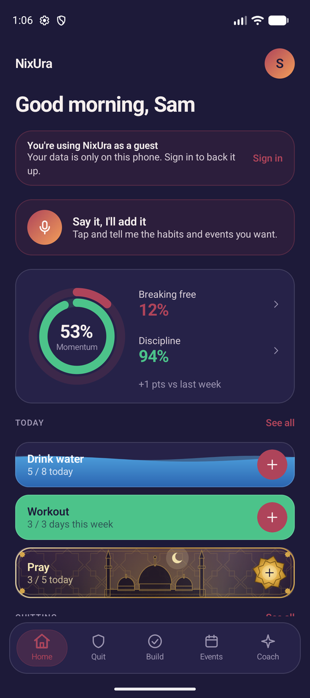 | 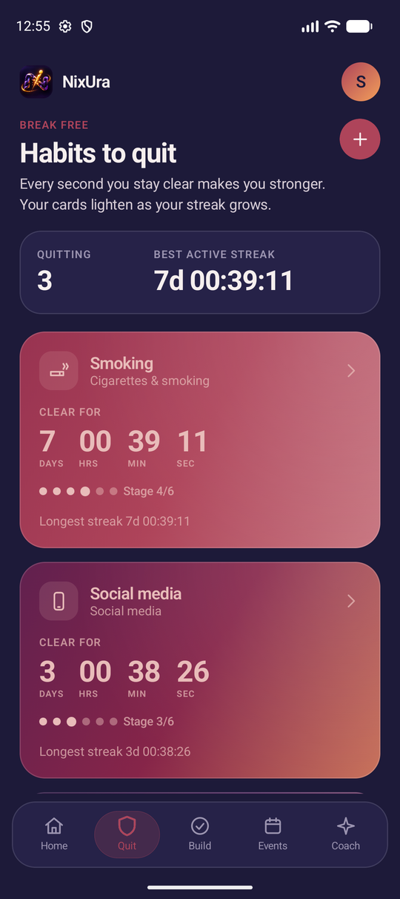 | 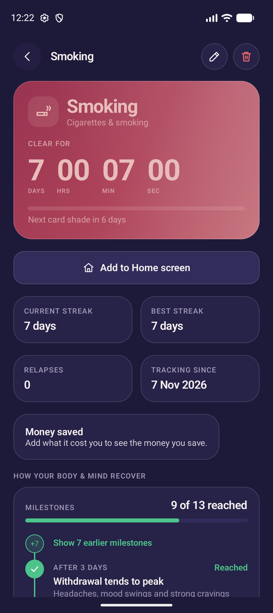 |
| **Habits to build** | **Prayer habit card** | **Good habit analysis** |
| 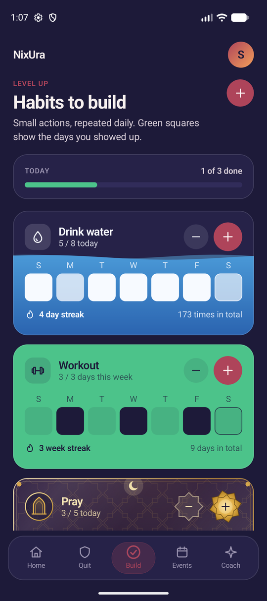 | 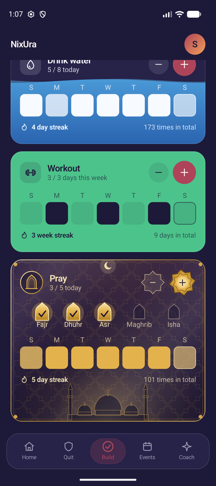 | 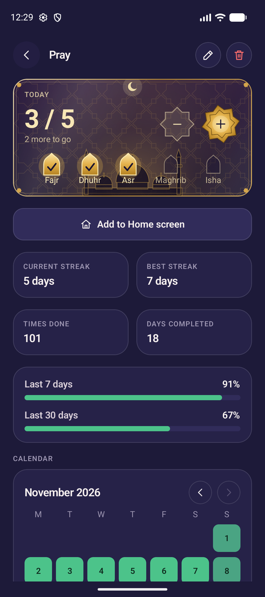 |
| **Event countdowns** | **Coach** | **Coach reply with a progress card** |
| 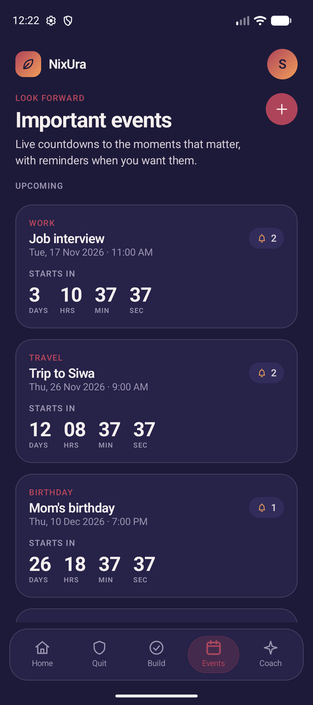 | 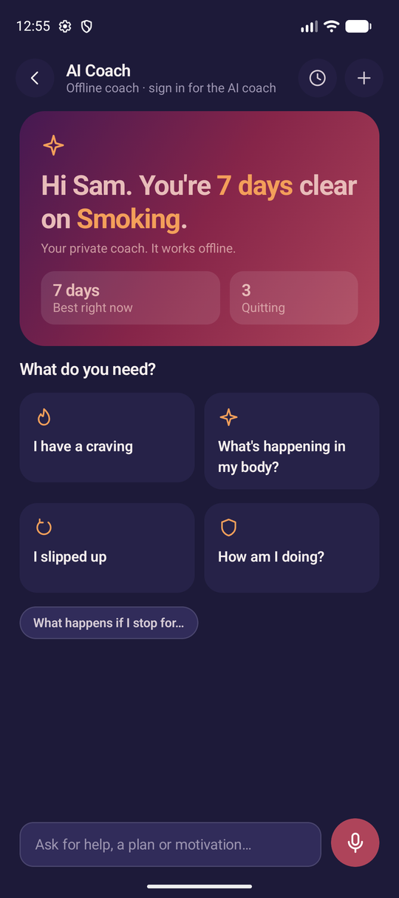 | 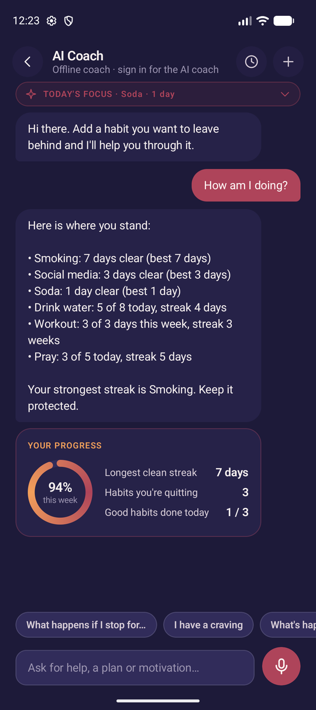 |
| **Adding a quit habit (name recognised)** | **Adding a good habit** | **Adding an event with reminders** |
| 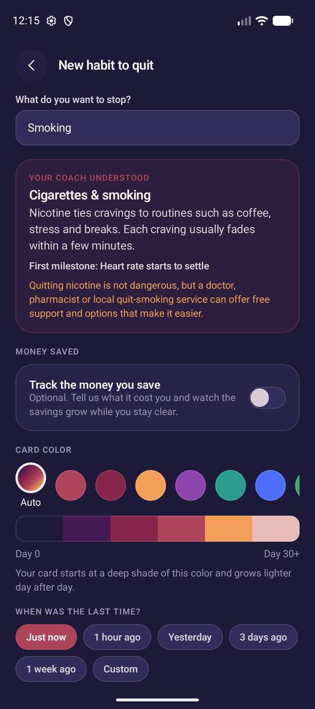 | 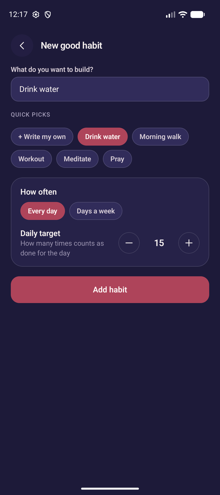 | 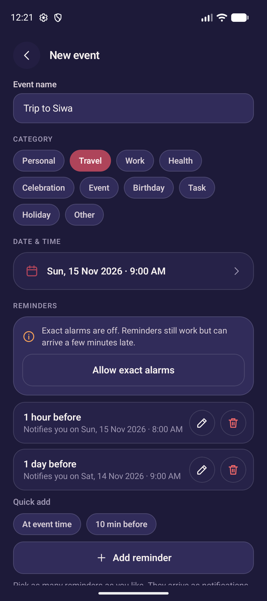 |
| **Home-screen widgets** | **Light theme** | **Light theme** |
| 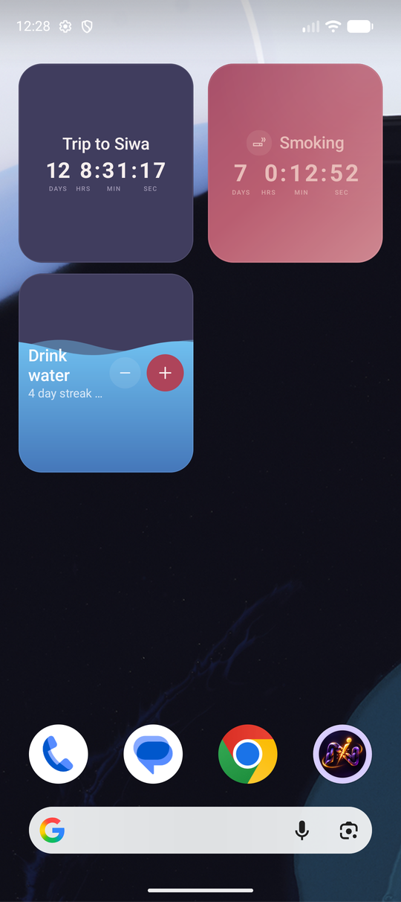 | 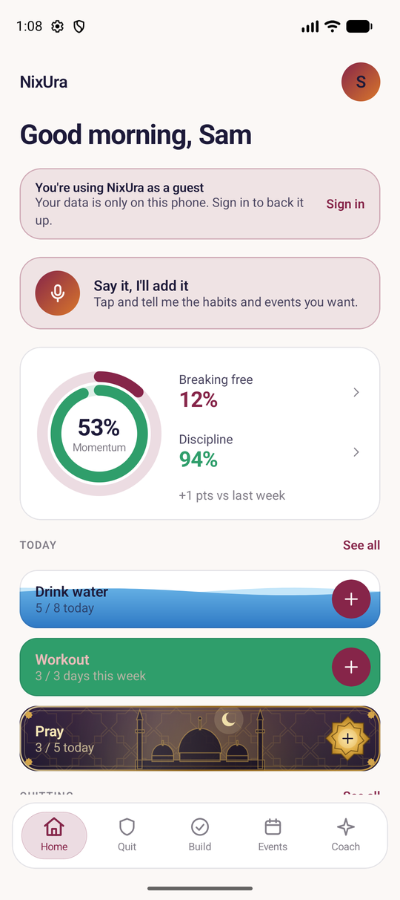 | 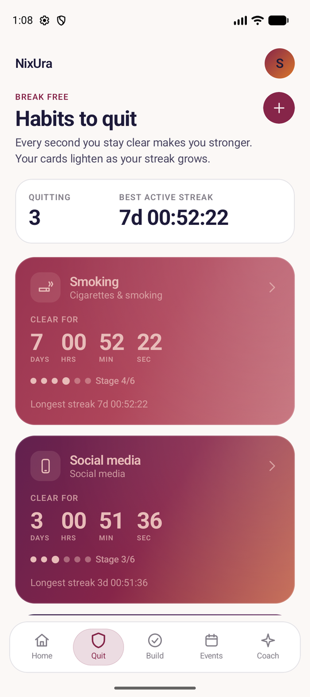 |
| **Welcome** | **Sign in** | **Settings** |
| 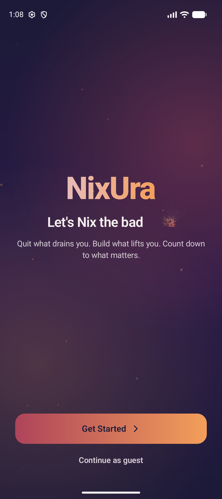 | 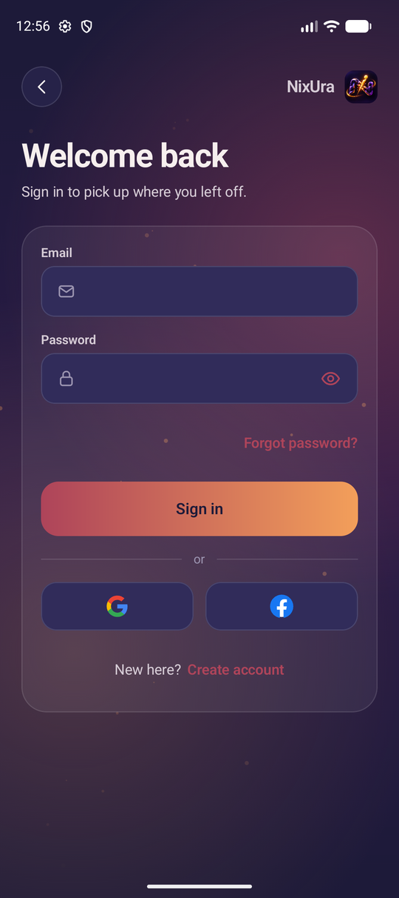 | 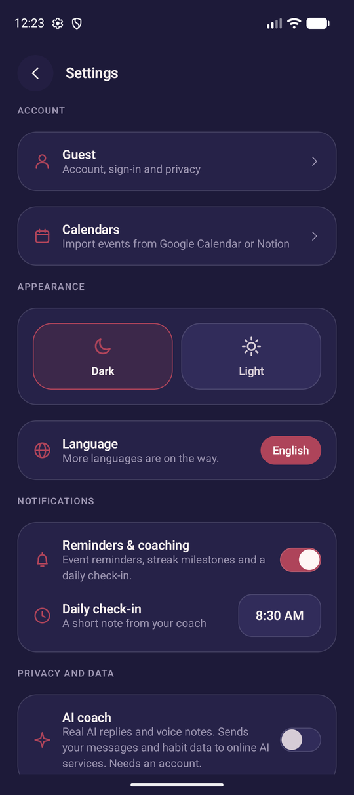 |

## Engineering highlights

| | |
|---|---|
| **One codebase, two platforms** | Domain, data, ViewModels and the entire Compose UI live in one `:shared` Kotlin Multiplatform module. Platform code (notifications, widgets, sign-in SDKs) sits behind `expect`/`actual` and Koin platform modules. |
| **Clean Architecture + MVVM** | A pure Kotlin `domain` (models, calculators, coach engine, notification planner, repository interfaces), a `data` layer (Room, mappers, repositories) and `presentation` (Compose screens, ViewModels, a small hand-written `Navigator`). |
| **Offline first** | Room KMP database at schema version 7 with a migration for every step from v1, checked against real SQLite by `tools/room_migration_check.py`. |
| **Accounts without an SDK lock-in** | Firebase Authentication through its REST API from shared Kotlin (email links, Google, Facebook), with tokens in encrypted storage and a single-flight token refresh. |
| **Serverless backend** | A TypeScript Cloudflare Worker with D1: Notion OAuth with AES-256-GCM encrypted tokens, plus an AI route that falls back through Gemini, Groq, Workers AI, Mistral and OpenRouter, with daily per-user limits. It never sends a name, email or account id to an AI. |
| **Live, battery-friendly widgets** | Classic RemoteViews widgets whose clocks are system `Chronometer`s, re-rendered by one inexact alarm at the next moment the text must change. A pure, unit-tested planner picks the layout from the widget size. |
| **Tested logic** | More than 460 unit tests in `shared/src/commonTest` (day math, streaks, scores, coach replies, habit recognition, notification and widget planning), plus the Worker's own test suite. |

## Project status

| Area | State |
|------|-------|
| Offline quit tracking (Room, MVVM, Koin) | Built and **verified earlier** (30 tests, `assembleDebug` passed on the author's machine before the UI merge) |
| NixUra UI merge + all features below | **Built, run and tested on Android — working properly (owner-confirmed).** First-run bugs fixed: stale Room database crash, screen padding from gesture insets. The Android app is considered feature-complete for the current scope. |
| Pure-logic unit tests (day math, coach, planner, scores, shade ramp, counters) | 71 tests compiled with plain `kotlinc` 2.4.20 and **passed** outside Gradle. They also live in `shared/src/commonTest`. |
| Room v7 schema + migrations | Audited with `tools/room_migration_check.py` (real SQLite: migrations vs entities, backfill, all queries, erase order, import dedupe index) — **OK**. v2 to v3 and v3 to v4 ran on the owner's phone with real data. v4 to v5 (money tracker, imported events) ran on the emulator with real data. v5 to v6 (weekly good habits) and v6 to v7 (coach progress cards) ran on the emulator over an existing install. |
| Accounts (Firebase) | **Moved to Firebase Authentication (2026-11-08, branch `feat/firebase-auth`).** Email + password with a verification **link** and a password-reset **link**, Google sign-in on Android, Facebook sign-in on Android (needs the client token, see [Accounts setup](#what-you-need-to-do-firebase-accounts)). 428 tests pass and the app builds; on the emulator the sign-in screen shows and a reset request reached the Firebase project. **Not yet tried on a phone:** creating an account, the verification link, Google and Facebook sign-in. iOS: email + password only, **unverified** (needs `GoogleService-Info.plist` and a Mac). |
| Cloud sync | **Paused** while it moves to Firestore (next step): the old server cannot check Firebase sign-ins, so changes stay queued on the phone and the sync status shows offline. The Firestore design is agreed (see docs/DEVELOPMENT_STATUS.md). |
| User-review redesign (dashboard, sign-in flow, gradients, explanations, chat history, starter guide) | Built and tested on the owner's phone (2026-11-03). |
| Round 3: water fill, card-style widgets, long-press delete with undo, money-saved tracker | Built, tests pass, **seen working on the emulator** (details in DEVELOPMENT_STATUS). Not yet run on the owner's phone. |
| Google Calendar and Notion import | Google works on the owner's Android phone (2026-11-04): Events, Birthdays, Tasks and Holidays for the user's country, each with its own category. Notion connects through a Cloudflare Worker (`workers/notion`); the owner linked a real Notion workspace from the phone on 2026-11-11 (see [Linking calendars](#linking-calendars-google-calendar-and-notion)). Google Calendar on iOS is not built yet. |
| AI coach | **Real AI coach built (2026-11-11), with voice notes and animated progress cards.** Signed-in users who agree get AI replies through NixUra's Worker, which tries five free AI services in order and falls back to the offline coach; 10 messages and 2 voice notes a day. AI chat and voice notes worked on the owner's phone (2026-11-11), answered by Gemini, with Groq and Cloudflare as working fallbacks. See [AI coach and voice notes](#ai-coach-and-voice-notes). |
| Android home-screen widgets (quit counter, good-habit quick log, events) | **Logic confirmed on a device by the owner** (numbers, live clock, "+"/"-", choosing a habit/event). The **card-style redesign** (widgets mirror the in-app cards, size-aware layouts) and the **"Add to Home screen" buttons** were **seen working on the Pixel 9 emulator on 2026-11-14** (quit counter and quick log placed with "Add to Home screen", events widget from the launcher's picker; see the Home-screen widgets screenshot) but **not yet run on a phone**. 90 pure-logic tests (planner, state mapping, quick-log use cases) compiled with plain `kotlinc` outside Gradle and **passed**. iOS widgets are **not implemented** (planned; need macOS, WidgetKit and an App Group). |
| App icon | **Official NixUra icon** (the broken chain with the glowing "i", owner's artwork, 2026-11-14): Android adaptive icon (`mipmap-*/ic_launcher_foreground.png` on `@color/ic_launcher_background`), legacy square and round icons for Android 7, a 512 px Play Store icon (`androidApp/src/main/ic_launcher-playstore.png`) and the iOS 1024 px `AppIcon`. Seen in the emulator's app drawer and splash screen and installed on the owner's phone; iOS not built yet. Inside the app there is no logo tile any more: welcome, sign-in, the top bar and Settings show only the name "NixUra". |
| iOS | **Approved target, not yet built or run.** Shared UI/logic is written for it (Compose host in `iosApp`, `iosMain` actuals). Reminders are a no-op placeholder until a `UNUserNotificationCenter` implementation is added. Needs macOS + Xcode to verify. |

> **Naming:** the app is **NixUra** everywhere: launcher label, Gradle project, iOS app name, docs. The app id is `com.adhamelgendy.nixura` (Android `applicationId`, Kotlin packages, iOS bundle id). It replaced the placeholder `com.example.reclaimapp` on 2026-11-05; an install of the old id is a different app to the phone, so uninstall it. The id must never change after publishing to a store.

If you are an AI assistant or new developer: read [AGENTS.md](AGENTS.md), then [docs/DEVELOPMENT_STATUS.md](docs/DEVELOPMENT_STATUS.md) (what happened, what is unverified, what is left).

## Features

The four main tabs (Home, Quit, Build, Events) are swipeable pages; the bottom bar has a water-droplet selection indicator that follows the swipe. The AI Coach opens full-screen from the bar. See [docs/agents/agent-1-handoff.md](docs/agents/agent-1-handoff.md).

All screens use the NixUra palette, dark theme by default (navy `#1D1A39` background), with a light theme switch in Settings. Screens slide and rise on navigation, tappable things dip under the finger, and everything falls back to plain fades with "remove animations". For a product overview aimed at investors, see [docs/FEATURES.md](docs/FEATURES.md).

| Screen | What it does |
|--------|--------------|
| Starter guide | Interactive tour over the real app, once per device (after sign-in or as a guest): spotlights the real controls on the real tabs, asks for an optional name, ends with "Add my first habit". Skippable; replay from Settings. |
| Landing | Shown when signed out. NixUra brand, "Let's Nix the bad Aura" where "Aura" blows away as ash and returns on a loop (stays still with "remove animations"), Get Started opens sign-in. "Continue as guest" warns that data stays on the phone only and the app runs completely offline. If a session ended and the last account's data is still on the phone, it offers Sign in or Start empty, so a guest never sees that account's data. Always dark. |
| Sign-in and account forms | Animated brand backdrop, form on a glass card, icons in the fields, eye icon for password visibility. Sign-in and create-account offer Google and Facebook as their logo buttons side by side under an "or" divider (Facebook only when configured), plus "Continue as guest" when signed out. A new account gets a verification link by email; the "Check your email" screen moves on by itself once it is tapped. "Forgot password?" mails a link to Firebase's page for choosing a new password. Switching between Sign in and Create account never stacks copies of the screens. Always dark. |
| Account sheet | Tap your picture at the top of any tab: name, email and sync status, Profile, Settings, and one-tap Sign out, or Sign in and Create account for guests. Going Back from Profile or Settings returns to the sheet. Account is reached from Settings. |
| Home | Dashboard: greeting; a sign-in banner for guests; two progress rings with Momentum in the middle, each part tappable to see how it was calculated; one-tap good-habit rows that fill with green; quit cards; next event; a short coach thought. With no data yet, one "Start with one thing" card replaces the empty sections. |
| Quit (bad habits) | Long-press any card (quit, good, event) to delete it: a sheet, a confirmation that names it, then "deleted · Undo" for 5 s; the delete removes its history and syncs. Cards with live days/hours/minutes/seconds. Each card is a gradient running from where the streak has been toward the shade it is growing into, and lightens over 0/1/3/7/14/30 days. Pick your own card color (starts ~30% brightness of it, ends in a light tint) or use the default brand colors. Card text is light or dark by whichever has the higher contrast on the card color. Under the counter: the color stages as dots and the **next milestone** with the time left (1, 3, 7, 14, 30, 60, 90, 180, 365 days, then every year); "Your longest streak yet" while the current streak is the record. Each quit card (Quit tab and Home) has a **⋯ button** and long-press with the same sheet: **I slipped** (asks first, then records the relapse), **Edit habit**, Delete; and a compact **"Craving?"** button that opens the coach already on that habit and sends "I'm having a craving for ... right now". "Longest streak" uses words ("5 days") like the detail screen. A card at the top shows the **next win** across all quit habits and the total saved (when all money trackers use one currency; otherwise the number of habits). |
| Quit habit analysis | Money saved this streak (live), units not consumed, daily cost and a bar per clean streak; big counter, progress to next shade, stats (current/best streak, relapses, tracking since), coach note, **"What happens if I stop for..." explorer** (chips + custom time, unverified), body & mind recovery timeline (a vertical rail: reached steps ticked in green, the next step highlighted with a pulsing ring, live countdown and progress, later steps in grey; older reached steps fold behind a "+N" node; the pulse stays still when the phone reduces motion), relapse history, edit / delete (same confirmation and Undo as long-press) / record relapse |
| Add/Edit quit habit | Name (typo-tolerant, EN + AR recognition picks the knowledge category; "Did you mean ...?" chip; offers to move a clearly good habit to Build), color picker + shade preview, backdated start ("last time was..."). For habits that are bought and counted (cigarettes, vaping, shisha, soft and energy drinks, coffee, tea, alcohol, fast food) an optional **money-saved tracker**: what exactly, per cigarette or per pack (with pack size), units per day, price, currency (16 offered; default = the phone's currency, else EGP). |
| Build (good habits) | Daily target counters (+/-), or **weekly habits** ("N days a week", 1-7, any days, Sunday to Saturday, a day counts once; e.g. medicine 3 days a week): the card fills with the week's progress, shows this week's days and a streak in weeks. Water habits (recognised from the name, typos and Arabic included) fill with **rising water**, a gentle wave, and a light sweep when full; other cards fill with more green on every tap and is solid green with a small bounce once the target is reached. 7-day strip, tappable streak. Add form: quick picks (Drink water, Morning walk, Workout, Meditate, Pray) plus a "+ Write my own" pill that jumps to the name field, and "How often": Every day or Days a week. |
| Good habit analysis | Same green fill on today's card, month calendar (squares get greener with progress, solid = done), tap any past day to correct it, 7/30-day completion (weekly habits: this week and the last 4 weeks, streaks and completed weeks in weeks), best streak, totals. Every stat tile explains itself when tapped. |
| Events | Imported Google Calendar and Notion events show a small source badge; their title and date are edited at the source, their category and reminders here. Live countdown cards (count-up after the date), multiple reminders per event: list with edit, remove + Undo, quick presets and custom lead times, validation, and a notice when notifications or exact alarms are blocked |
| AI Coach | **Full-screen** (top bar and bottom nav hidden; compact header with back arrow, mode line, chat history and new chat; system back returns to Home). A new chat opens with a short welcome card (one line with the key numbers highlighted, your stats, four big starting points); until you write in a chat its greeting is rewritten each time it opens, so it always matches your current habits and name. Offline chats kept as a history on this phone (not synced; open, continue or delete them), "today's focus" strip you tap to pick which quit habit to talk about (the coach then uses that habit's data), quick prompts (incl. "What happens if I stop for...", answered from the habit's timeline for any duration, EN/AR, typo-tolerant; unverified), craving/relapse/progress/body/plan replies, crisis safety reply |
| Prayer habit | A good habit whose name means prayer ("pray", "Salah", "namaz", Arabic صلاة, typos allowed; `PrayerHabitDetector`) sets itself to **5 a day**, the add form turns amber gold from the very top of the screen to the very bottom (system bars included), with a star pattern, a crescent and a mosque in a golden dawn, and a polished-gold "Add habit" button (halo, gloss, engraved edge, a star at each end, a looping light sweep; `PrayerGoldButton`); the card is a gold Islamic-art card: night sky with an eight-pointed-star pattern, a crescent, a mosque silhouette in a golden dawn that grows with every prayer, a mihrab-arch badge, a double gold frame with corner stars, a light that loops across endlessly, five mihrab arches (Fajr, Dhuhr, Asr, Maghrib, Isha) that turn gold with a tick, star-shaped buttons, and a burst of golden stars on every counted prayer; solid gold when all five are done. Honours "remove animations". Code in `presentation/components/IslamicArt.kt` and `PrayerGoldWash.kt`. The home-screen widget of a prayer habit is drawn with the same code (still picture: no shine loop or burst). |
| Category glyphs | Every habit card and widget shows an icon for its kind, worked out from the name (cigarette for smoking, burger for junk food, phone for social media, drop for water, dumbbell for workout, book for reading, mihrab arch for prayer...); a shield (quit) or a leaf (build) when the name is not recognised. `domain/recognition/HabitTopic.kt`, icons in `presentation/components/TopicIcons.kt`. |
| Home-screen widgets (Android) | Three resizable widgets drawn like the in-app cards: **Quit counter** (same gradient and corner glow as the card, money saved in whole units on the large size, everything centered, glyph badge, habit name, days + live clock with DAYS/HRS/MIN/SEC labels (6.5 sp, same size as on the events widget; the hours field is always shown, "0" in the first hour of a day; the label cells are measured from the real clock text so HRS/MIN/SEC are centered under their digits), longest streak; no category line and no stage row), **Good habit quick log** (fills like the card: green, or a still picture of the water level for water habits, redrawn on every change; today's count, "-" and "+" buttons that record without opening the app, progress bar, 7-day strip, streak row; the week strip has priority over the day streak row, which has priority over the progress bar; the quit and good widgets use only 8 dp of inner padding so more rows fit), **Events** (category, title, date without the year, countdown / count-up; **no reminder count**, reminders stay in the app). Tap opens the habit or Events. Choose the habit/event when placing the widget, or press **"Add to Home screen"** on a quit-habit analysis screen, a good-habit analysis screen, or an event's edit screen: the launcher then shows its own placement UI, where you pick the page/position and can resize or move the widget afterwards. Layout adapts to size (stacked, one row, two compact lines); quit and event titles are never hidden and their optional rows only appear when they fit; on the one-row quit widget (3x1) the name is made smaller (after dropping the badge) rather than broken in the middle of a word. A prayer habit's widget is the gold prayer card (arch badge, star buttons, prayer arches with names, mosque). Follows the app's dark/light setting. |
| Profile | Opened from the account sheet. A centered identity card (picture, name, email, age (local only), Edit profile), the "Breaking free" and "Discipline" scores as two tiles side by side (tap to see how each was calculated, habit by habit), a Totals block of four stat tiles, and the nearest event countdown (imported events included). Settings is in the account sheet. |
| Account | Settings > Account, built like Settings (icon, title and hint on every row): who is signed in; **Cloud sync** status with Sync now; **Sign-in and security** (change password, only for accounts that have one; sign out); **Legal** (Privacy Policy, Terms of Use); **Danger zone** (delete account; Google/Facebook accounts confirm without a password). Signing out uploads pending changes, then clears the phone. Guests see Create account / Sign in and stay completely offline. Buttons never cut their label: a long one wraps, and a dialog with long labels stacks its two buttons. |
| Settings | Reached from the account sheet. Five sections, every row with an icon, a title and a short hint: **Account** (account row showing the signed-in email, Calendars: link Google Calendar or Notion), **Appearance** (Dark/Light, language: English only for now), **Notifications** (switch + daily check-in time), **Privacy and data** ("Share anonymous usage stats": Firebase Analytics, off until turned on, per device; erase all data), **About** (replay the starter guide, version). |

Notifications: event reminders, streak milestones and a daily check-in. **Android:** implemented with `AlarmManager`, restored after reboot. **iOS:** not implemented yet (planned with `UNUserNotificationCenter`).

## Roadmap (what remains)

Everything above is working on Android. The owner's remaining work, in no fixed order:

1. **Fine-tune the UI.** Polish spacing, typography, animations, small-screen and light-theme details across all screens.
2. **AI coach: try it signed in on a phone, add the API keys** (see [AI coach and voice notes](#ai-coach-and-voice-notes)). Later: a paid plan for more than the free daily uses, voice notes on iOS, and an AI model that runs on the phone itself.
3. **Richer knowledge about specific bad habits, understood from free text.** Add curated info (effects, withdrawal, recovery timeline, tips, triggers) for many more habits, and recognise a habit however the user typed it (synonyms, typos, different phrasing, multi-word names, other languages) so each habit feels personalised: the habit card, analysis screen, coach replies and milestones adapt to it. Today the coach matches the name by simple keyword category (`HabitKnowledgeBase`); this item generalises that. *Round 2:* a catalog of 20 substance, food and drink habits with dense hour/day timelines is written (`domain/coach/catalog/SubstanceCatalog`, unmerged and unverified, see `docs/DEVELOPMENT_STATUS.md`), and a catalog of 28 behavioural, screen, mental and body-reflex habits (`domain/coach/catalog/BehaviorCatalog`, unmerged and unverified, same file).
4. **Make the app work on iOS.** Build and run `iosApp` on a Mac, fix first-run errors, implement iOS notifications, verify layout/status bar on a real iPhone, then TestFlight.

Smaller backlog (not blocking): Arabic/RTL and translated content, accessibility labels, store readiness (privacy policy, store listing; the app id and the launcher icon are done), more tests, backup/export. Widgets: Android done (see Status), **iOS widgets planned** (WidgetKit + App Group, needs macOS). Details: [docs/DEVELOPMENT_STATUS.md](docs/DEVELOPMENT_STATUS.md).

## Visual identity

| Color | Hex |
|-------|-----|
| Deep navy | `#1D1A39` |
| Deep purple | `#451952` |
| Muted plum | `#862549` |
| Rose | `#AE445A` |
| Warm orange | `#F39F5A` |
| Blush pink | `#E8BCB9` |

Semantic tokens (dark/light) are in `presentation/theme/NixColors.kt`. UI was adapted from a v0 design ("NixUra UI", a Next.js mock-up) into Compose; icons are drawn in code (`components/NixIcons.kt`); the settings gear is the official Material "Settings" icon from `material-icons-core`. Icon libraries are allowed.

## Technology stack

| Technology | Version |
|------------|---------|
| Kotlin | 2.4.20 |
| Compose Multiplatform | 1.12.1 |
| Android Gradle Plugin | 9.1.1 |
| Material 3 (Compose) | 1.12.0-alpha03 |
| Room KMP / KSP | 2.7.2 / 2.3.12 |
| Koin | 4.0.1 |
| Firebase BoM (Analytics only; accounts use the Firebase Auth REST API from shared code) / google-services plugin | 35.1.0 / 4.5.0 |
| Credential Manager / Google ID (Google sign-in) | 1.6.0 / 1.2.1 |
| Facebook Login | 19.0.1 |
| Material icons core (`org.jetbrains.compose.material:material-icons-core`, used for the settings gear) | 1.7.3 |
| minSdk / compileSdk | 24 / 37 |
| Notion Worker (`workers/notion`): Wrangler / jose / TypeScript, on Cloudflare Workers + D1 | 4.150.0 / 5.9.6 / 5.6.3 |

## Architecture

Single `:shared` module, Clean Architecture + MVVM:

- **`domain`** (pure Kotlin): `model`, `calculator` (streaks, scores, counters, good-habit stats), `time` (calendar math), `coach` (offline coach + knowledge base; `coach/catalog` holds curated per-habit data, e.g. `SubstanceCatalog` for substances, food and drink and `BehaviorCatalog` for behavioural, screen, mental and body-reflex habits), `recognition` (typo-proof habit matching + good/bad classification), `notification` (planner, scheduler interfaces), `widget` (widget states, nearest-event selection, refresh planning, size-to-layout planning, the `WidgetPinner` port; plain Kotlin shared with the Android widgets), `repository` interfaces, `usecase`.
- **`data`**: Room entities/DAOs/migration (`data/local`), mappers, repository implementations. `data/auth`: accounts on Firebase Authentication through its REST API (`FirebaseAuthApi`, `FirebaseAuthRepository`, `FirebaseSession` for the 1-hour ID token and its single-flight refresh), shared by Android and iOS; tokens stay in `SecureStore`.
- **`presentation`**: `screen`, `components`, `theme`, `strings` (all UI text; a plain `open class`, not a giant data class, see Troubleshooting), `navigation` (tiny `Navigator`, no nav library), ViewModels per feature.
- **`di`**: Koin `appModule()`; platform modules provide the database, `NotificationScheduler` and `NotificationPermissionGateway`. The Android platform module also registers the widget use cases (`LoadWidgetStateUseCase`, `Increment/DecrementGoodHabitTodayUseCase`, `ObserveWidgetDataChangesUseCase`); the Android `WidgetPinner` is loaded by `NixUraApplication`, and the UI hides "Add to Home screen" when no `WidgetPinner` is bound (iOS).
- **`:androidApp`**: `NixUraApplication` (starts Koin), `MainActivity`, `notifications/` (alarm scheduler, receivers, permission bridge). Widgets: `widgets/` (three `AppWidgetProvider`s, `WidgetRenderer`, `WidgetUpdater`, quick-log / system / pin receivers, `WidgetConfigActivity`, `AndroidWidgetPinner`); `MainActivity` also handles widget deep links; `NixUraApplication` starts the widget updater and registers the Android `WidgetPinner` binding. Layouts `res/layout/widget_*.xml` are generated by `tools/gen_widget_layouts.py`.
- **iOS**: `shared/src/iosMain` (`MainViewController`, database builder, `platformModule()`, UTC offset, system bars) and `iosApp/` (SwiftUI `ContentView` hosting the Compose view controller; framework name `Shared`).

Database: Room **version 7** (`MIGRATION_1_2` … `MIGRATION_6_7` in `data/local/Migrations.kt`; v5 adds the `cost_*` columns on `habits` and `source`, `external_id`, `external_updated_at`, `all_day` on `events`; v6 adds `weekly_target` on `good_habits`, null = daily; v7 adds `visuals` on `coach_messages`). Tables: `habits`, `habit_events`, `good_habits`, `good_habit_logs`, `events`, `coach_conversations`, `coach_messages`, `preferences`.

The coach is behind `CoachResponder` (`RuleBasedCoachResponder` today). A real AI is a second implementation; see the upgrade guide.

## Project structure

```
NixUra/
├── AGENTS.md                      # entry instructions for AI agents
├── androidApp/                    # Android app: Application, MainActivity, notifications, manifest
├── docs/
│   ├── screenshots/               # app screenshots used in this README
│   ├── assets/                    # README icon and hero banner
│   ├── PROJECT_CONTEXT.md         # product + architecture reference
│   ├── DEVELOPMENT_STATUS.md      # what happened, what is verified, what is left
│   ├── agents/agent-1-handoff.md  # swipe tabs, droplet nav bar, reminder edit/remove (unverified, see file)
│   ├── agents/agent-2-handoff.md  # accounts: backend, email OTP login, token security, privacy docs
│   ├── agents/agent-3-handoff.md  # cloud sync: rules, verification state, known limitations
│   ├── PHASE2_ARCHITECTURE.md     # original architecture (see addendum at the end)
│   └── AI_COACH_UPGRADE.md        # how to make the coach a real AI (free options)
├── firebase.json, .firebaserc     # Firebase Hosting config (project nixura)
├── hosting/public/                # nixura.web.app: the branded email-link page (auth/action), home and 404 pages
├── iosApp/                        # iOS app: Xcode project + SwiftUI host that embeds the shared Compose UI
├── workers/notion/                # Cloudflare Worker: Notion link and the AI coach (free AI chain, daily limits); see its README
├── tools/room_migration_check.py  # validates the migrations + DAO SQL against the entities (python3, no deps)
├── tools/phone_link.ps1           # Windows dev helper: keeps USB phones linked to the local backend (adb reverse)
├── shared/src/{commonMain,androidMain,iosMain,commonTest}/kotlin/com/adhamelgendy/nixura/
└── .cursor/skills/                # workflow skills (onboarding, feature dev, verification, handoff)
```

## Build and run

```bash
# Windows
gradlew.bat :androidApp:assembleDebug
# macOS / Linux
./gradlew :androidApp:assembleDebug
```

Prerequisites (Android): JDK 11+, Android Studio or Android SDK.

### iOS (macOS only)

Prerequisites: a Mac, Xcode, and the Kotlin Multiplatform tooling (Android Studio with the KMP plugin or IntelliJ is optional; Gradle works from the terminal).

```bash
# compile and link the shared framework for the simulator
./gradlew :shared:linkDebugFrameworkIosSimulatorArm64
# unit tests on the iOS simulator
./gradlew :shared:iosSimulatorArm64Test
```

Then open `iosApp/iosApp.xcodeproj` in Xcode, pick a simulator or a connected iPhone, set your signing team under Signing & Capabilities, and press Run. Xcode's build phase calls Gradle to build the `Shared` framework. Sharing with testers: TestFlight needs a paid Apple Developer account; a free Apple ID can install on your own connected device but the app expires after 7 days. iOS has **not been built yet**, so expect some first-run fixes.

### Troubleshooting: "Room cannot verify the data integrity"

`IllegalStateException: Room cannot verify the data integrity ... Expected identity hash: X, found: Y` means the
database file already on the device/emulator was created by an earlier build whose v2 schema differed from the
current one (the schema changed while the version stayed 2 during development). It is not a compile error.
Fix: uninstall the app (or Settings > Apps > NixUra > Storage > Clear data, or `adb uninstall com.adhamelgendy.nixura`)
and run again. Destructive fallback is deliberately **not** enabled, so release data is never wiped silently.
Once the app ships, any schema change must bump the version and add a migration.

### Troubleshooting: `VerifyError ... StringsKt.<clinit> ... expected N argument registers`

The app crashes at launch with `Verifier rejected class ...presentation.strings.StringsKt`. Cause: `Strings` must stay a plain `open class` with `open val` members in its body. As a `data class` with one constructor parameter per string (256+), `Strings()` compiles to a ~265-argument constructor call that D8 mis-encodes. Fix: keep new strings as `open val` members of `Strings` (never as constructor parameters); Build > Clean Project, then run. Languages are subclasses that override only what differs.

### Troubleshooting: content does not fill the screen

If screens show large gaps on all sides, the root layout is reserving system *gesture* insets. `AppRoot` (`presentation/screen/AppShell.kt`) must use `windowInsetsPadding(WindowInsets.safeDrawing)`, not `safeContentPadding()`.

### Troubleshooting: Google Calendar Connect fails

Read the reason with `adb logcat -s NixUraGoogleAuth Auth Auth.Api.Credentials` while you tap Connect. The app logs Google's status code there, never the token or the account.

- `UNREGISTERED_ON_API_CONSOLE` or "This android application is not registered to use OAuth2.0": no Android OAuth client matches the package name and SHA-1 of the key that signed this build (the app says "isn't set up in this build yet"). Fix step 4 of [What you need to do: Google Calendar](#what-you-need-to-do-google-calendar). Check the SHA-1 of the installed build with `apksigner verify --print-certs app.apk`.
- "Google Calendar wasn't connected": the consent screen was closed without choosing.
- "You're offline" after a long spinner: Google's own services on the phone timed out (`getToken() -> NETWORK_ERROR`, 30 s). Try again on a stable connection.
- "Google access wasn't granted": Google refused. The usual causes are an account that is not a test user while the app is in Testing, or `calendar.readonly` missing under Data access; the log line has the exact status.

## Accounts (Firebase)

Accounts live in the Firebase project **`nixura`** (Spark plan). The app talks to Firebase Authentication through its REST API from shared Kotlin, so Android and iOS share one implementation; the Firebase SDK is only used on Android for the opt-in usage stats. Tokens are kept in the encrypted `SecureStore` and never logged.

### What you need to do: Firebase accounts

1. **Firebase config file (not in git):** download `google-services.json` from Firebase → Project settings → Your apps → *NixUra Android* and put it in `androidApp/`. The build fails without it. For iOS, register an iOS app with bundle id `com.adhamelgendy.nixura` and add its `GoogleService-Info.plist` to the `iosApp` target.
2. **Sign-in methods** (Firebase → Authentication → Sign-in method): Email/Password, Google, Facebook (App ID + App Secret from the Meta app; the secret stays in Firebase only).
3. **SHA-1:** the debug key's SHA-1 (`9B:AA:…:C3:F3`) is registered on the Firebase Android app. A release key needs its own SHA-1 there (and a new Facebook key hash) before publishing.
4. **Facebook client token:** Meta → App settings → Advanced → *Client token*. Put it in `~/.gradle/gradle.properties` (outside the repo) as `nixuraFacebookClientToken=...`. Without it the Facebook button is hidden and the Facebook SDK is not started. The App ID defaults to NixUra's (`nixuraFacebookAppId` overrides it).
5. **Testers:** while the Meta app is unpublished, only people under App roles → Roles can use Facebook sign-in.

### Troubleshooting: sign-in

Read `adb logcat -s NixUraSignIn` while you tap a button (Google / Facebook errors; tokens and emails are never logged). "This way of signing in isn't available on this phone yet" means the method is switched off in the Firebase console, `google-services.json` is missing its web client (download it again after enabling Google), or on iOS that Google / Facebook are not built yet.

### Email link page (Firebase Hosting)

The links in the verification and password-reset emails open a NixUra-styled page instead of Firebase's plain one: `hosting/public/auth/action.html` with `hosting/public/assets/auth-action.js`. It confirms the email, undoes an email change, or shows a form for the new password (same rules as the app: `AuthValidation.kt`), all through the Identity Toolkit REST API. It stores nothing, removes the one-time code from the address bar, ignores `continueUrl` (no redirects) and is served with a strict Content-Security-Policy (`firebase.json`).

```bash
# preview on your computer (http://localhost:5055)
firebase serve --only hosting --port 5055
# publish to https://nixura.web.app
firebase deploy --only hosting
```

Then in Firebase → Authentication → Templates → **Customize action URL**, enter `https://nixura.web.app/auth/action` (one setting for all templates). To undo, clear that field: the emails go back to Firebase's page.

## AI coach and voice notes

Signed-in users who agree get a real AI coach, and can add habits and events by voice. Guests, and anyone who declines, keep the offline coach.

- **Server:** the AI routes live in the same Cloudflare Worker as Notion (`workers/notion`, `src/ai/`). The app sends the message, the habits with their numbers and the events of the next 30 days. It never sends a name, an email or an account id.
- **Free AI chain:** the Worker tries Gemini → Groq → Cloudflare Workers AI → Mistral → OpenRouter, and moves on when one fails or is out of free quota. If none answers, the app's offline coach replies. The order is the `AI_CHAIN` setting in `workers/notion/wrangler.jsonc`; a service without a key is skipped.
- **Limits:** 10 AI messages and 2 voice notes per user per day (`AI_CHAT_PER_DAY`, `AI_VOICE_PER_DAY`), counted in the D1 table `ai_usage`. A use only counts when an AI really answered.
- **Voice notes:** the mic card on Home, or the mic button in the coach. Up to 60 seconds. The app shows what the AI understood, and adds only what the user confirms. Each item has a pencil button that opens a small edit form (quit or build, the name, every day or days a week and the target, the event title, date and time, and category), so a misheard "15 cups" can become "5 cups" before it is added. The edit form uses the same rules as the add forms (a name, a target of 1 to 99, 1 to 7 days a week, an event in the future); an item that breaks them is marked "needs a fix" and is not added until it is fixed. Android only for now.
- **Progress cards:** when the user asks how they are doing, the reply comes with an animated card (streak ring, 7-day bars or an overview). The AI only picks which card; the numbers are the app's own. The offline coach shows them too.
- **Consent:** asked once before the first AI use; Settings → Privacy and data → AI coach turns it off again.

### What you need to do: AI keys

Cloudflare Workers AI needs no key and already works. Each key below adds one more free service; any of them can be skipped. In `workers/notion`, run the command and paste the key when it asks (it goes straight to Cloudflare, never into git or the app).

| Service | Where to get the key | Command |
|---|---|---|
| Google Gemini | [aistudio.google.com/apikey](https://aistudio.google.com/apikey) → Create API key | `npx wrangler secret put GEMINI_API_KEY` |
| Groq | [console.groq.com/keys](https://console.groq.com/keys) → Create API Key | `npx wrangler secret put GROQ_API_KEY` |
| Mistral | [console.mistral.ai](https://console.mistral.ai) → API Keys → Create new key (free plan) | `npx wrangler secret put MISTRAL_API_KEY` |
| OpenRouter | [openrouter.ai/keys](https://openrouter.ai/keys) → Create key | `npx wrangler secret put OPENROUTER_API_KEY` |

A key works a few seconds after the command; no redeploy and no app update. Model names are settings in `wrangler.jsonc` (`GEMINI_MODEL` and so on); change one and run `npx wrangler deploy` if a provider retires a model.

**Before a public launch:** Google's free Gemini tier may use what is sent to improve its products, says not to send personal information, and is not allowed for users in the EU, UK or Switzerland. Move Gemini to the paid tier or take it out of `AI_CHAIN` first.

## Linking calendars (Google Calendar and Notion)

Settings → Integrations links a calendar. For Google you pick what to import: **Events** (your main calendar), **Birthdays**, **Tasks** (Google Tasks with a due date; done or deleted tasks are removed) and **Holidays in your country** (Google's public holiday calendar for the country of the phone's mobile network, else the SIM, else the region setting; off by default). Highlighted chips are imported; tap one to turn it on or off. Each gets its own category (Event, Birthday, Task, Holiday); a category you change yourself is kept. Imported events go into Events with a source badge, count down like any event, show on Profile ("nearest event") and on the events widget, and sync to your other devices. NixUra only **reads** them: edit or delete them at the source, and the next sync follows (also cancelled, deleted and recurring events; recurring events arrive as single occurrences; whole-day events are kept as whole days; time zones are converted). If you delete an imported event in NixUra, it stays deleted unless it is edited at the source again. What NixUra removes itself (an entry turned off, Disconnect) comes back when you turn it on again or reconnect. Disconnect removes everything that was imported.

Linking needs an account: guests make no network calls. Sync runs when you tap "Sync now", every 2 minutes while the app is open, and in the background (WorkManager with the cloud sync, at most every 15 minutes, only on a network). Google Tasks has no push, so this is polling.

How the pieces work:

- **Google Calendar and Tasks:** authorized on the phone with Google's Authorization API, read-only scopes `calendar.readonly` and `tasks.readonly` only. The access token is asked for at each sync and never stored; Disconnect revokes it and clears Google's cached copy on the phone. Events and Birthdays read the primary calendar with `eventTypes` (`default` + `fromGmail`, or `birthday`); calendar feeds are incremental with Google sync tokens (an expired token, HTTP 410, starts that feed over); tasks are read in full each time. If the Tasks API is off or not allowed, tasks are skipped and the rest still imports. Code: `androidApp/.../integrations/AndroidGoogleAuthorizer.kt`, `shared/.../data/integration/GoogleCalendarSource.kt`.
- **Notion:** a public integration with OAuth through NixUra's server, a Cloudflare Worker that checks the user's Firebase sign-in on every call. The client secret and your Notion token stay on the server, the token encrypted with AES-256-GCM (D1 table `notion_links`). The app only receives event data. Pick one database, its title property and its date property (suggested automatically). Incremental with `last_edited_time`, plus a full read every 3 days that catches deleted pages; 429 answers are retried after Notion's `Retry-After`. Code: `workers/notion/src/`, `shared/.../data/integration/NotionSource.kt`. Deleting an account removes its Notion link first.
- **Duplicates** are impossible by design: one row per (`source`, `external_id`), enforced by a unique index; the rules are in `domain/integration/ImportPlanner.kt` (unit-tested).

### What you need to do: Google Calendar

1. Open [Google Cloud Console](https://console.cloud.google.com/) and create a project (for example "NixUra").
2. **APIs & Services → Library**: enable **Google Calendar API** and **Google Tasks API**.
3. **Google Auth Platform → Branding / Audience / Data access** (the OAuth consent screen):
   - User type: **External**. Fill in the app name, support email and developer email.
   - Data access → **Add scope** → `https://www.googleapis.com/auth/calendar.readonly` and `https://www.googleapis.com/auth/tasks.readonly` (and nothing else). A link made before the Tasks scope existed asks again: Disconnect, then Connect.
   - Audience: while the app is in **Testing**, add your own Google account (and testers) as **test users**.
4. **Clients → Create client → Android**:
   - Package name: `com.adhamelgendy.nixura`
   - SHA-1 of your debug key: `keytool -list -v -keystore "%USERPROFILE%\.android\debug.keystore" -alias androiddebugkey -storepass android -keypass android` (macOS/Linux: `~/.android/debug.keystore`).
   - Later add a second Android client with the SHA-1 of your **release** key, or of the **Play App Signing** key from Play Console → Setup → App integrity.
   - Android clients have **no secret**, and nothing goes into the app's code: Google recognises the app by its package name and signature. Until this client exists the app says "Google Calendar isn't set up in this build yet" (Google's log says `UNREGISTERED_ON_API_CONSOLE`; see [Troubleshooting: Google Calendar Connect fails](#troubleshooting-google-calendar-connect-fails)).
5. Before a public release: `calendar.readonly` (and `tasks.readonly`) are **sensitive scopes**, so Google must verify the app (privacy policy URL, home page on a verified domain, a short video of the consent flow). Until then only test users can link, and Google may ask them to agree again after about a week.

### What you need to do: Notion

Done on 2026-11-11; kept here in case it has to be redone. Notion now calls integrations "connections".

1. Open [Notion → Developer connections](https://www.notion.so/profile/integrations) → **New connection** → name NixUra, authentication method **OAuth**, installable in any workspace.
2. On the connection's page, add the **Redirect URI**: `https://nixura-notion.nixura-notion-worker.workers.dev/v1/integrations/notion/callback`.
3. Capabilities: **Read content** only, and **No user information**.
4. Give the Worker the two values. In `workers/notion`, run each command and paste the value when it asks (it goes straight to Cloudflare, never into git or the app):
   ```
   npx wrangler secret put NOTION_CLIENT_ID
   npx wrangler secret put NOTION_CLIENT_SECRET
   ```
5. In the app: Settings → Calendars → Notion → Connect. In Notion's page, share the database that holds your events, then come back to the app and pick it.

Notion has no "revoke" call for public integrations: Disconnect deletes the token on the server, and you can also remove NixUra under Notion → Settings → Connections.

**Not built yet:** Google Calendar on iOS (needs an iOS OAuth client and Google's iOS sign-in; the iOS app says it is not available). Notion works on both platforms, because the server does it.


## Testing

```bash
gradlew.bat :shared:testAndroidHostTest
gradlew.bat :shared:allTests
```

The Notion Worker has its own tests: `cd workers/notion && npm install && npm test && npm run typecheck`.

Run these first after pulling the merged UI. After changing any Room entity, DAO or migration also run `python3 tools/room_migration_check.py` (edit it if you add tables). iOS simulator tests only run on macOS (they are skipped on Windows/Linux).
Widget logic tests live in `shared/src/commonTest/.../domain/widget/` and `.../usecase/WidgetUseCasesTest.kt` (90 cases). Widgets themselves need a device: add each widget (from the launcher and from "Add to Home screen"), compare with the in-app card, tap "+"/"-" (also with the app killed), resize from 1 to 4 rows and 2 to 5 columns (check the title never disappears and nothing overlaps), rotate, reboot, change time zone, cross midnight, delete the habit/event, switch theme, tap each widget to check the deep link.

### Widgets (Android)

The running clock is a system-driven `Chronometer` (whole days are text, hours:minutes:seconds ticks with no wake-ups). One inexact alarm (no exact-alarm permission) is armed for the earliest moment the printed text must change: a counter's whole-day rollover, the Chronometer switching between MM:SS and H:MM:SS (first hour of each day), an event passing, or local midnight. Data changes while the app runs re-render after a 500 ms debounce; boot, app update and time/date/time-zone changes re-render and re-arm the alarm. Trade-off: Doze can delay the alarm by minutes. `WidgetLayoutPlanner` (pure, tested) picks the layout family from the widget size and adds optional rows only while they fit. Widget text lives in `presentation/strings/Strings.kt` (the `widget*` members, English defaults; picker labels in `androidApp/res/values/strings.xml`). Classic RemoteViews, no Glance dependency (not verifiable against AGP 9.1.1 / Compose 1.12.1 when written). The Chronometer is given the format `0:%s` inside the first hour of a day so it always prints H:MM:SS (the HRS label never disappears); the re-render alarm also fires when the hours field gets its second digit (10 h) so the HRS label stays centered under it. After changing the widget look, edit and re-run `python3 tools/gen_widget_layouts.py`.

Manual QA checklist: starter guide; add quit habit with/without color and backdated start; watch counter and shade; relapse; add good habit and tick days; past-day edit; add event with reminders and check the notification; coach chat; theme switch; erase data; upgrade from a v1 database.

## Development workflow

- Android and iOS are both supported targets; AI agents and developers may change iOS code freely (see "iOS is a first-class target" in [AGENTS.md](AGENTS.md)). Anything not compiled on the machine used must be marked unverified.

- Read [AGENTS.md](AGENTS.md) and [docs/DEVELOPMENT_STATUS.md](docs/DEVELOPMENT_STATUS.md) when starting work.
- Conventional Commits; verify builds/tests before committing; never claim a build passed unless it ran.
- Skills in `.cursor/skills/` (e.g. `nixura-project-onboarding`) can be invoked in new chats.
- **Docs are kept current automatically:** after any change, agents (and developers) update this README and `docs/` as needed — see "Documentation auto-update rule" in [AGENTS.md](AGENTS.md).

## License

Not yet selected — no license file is included.
